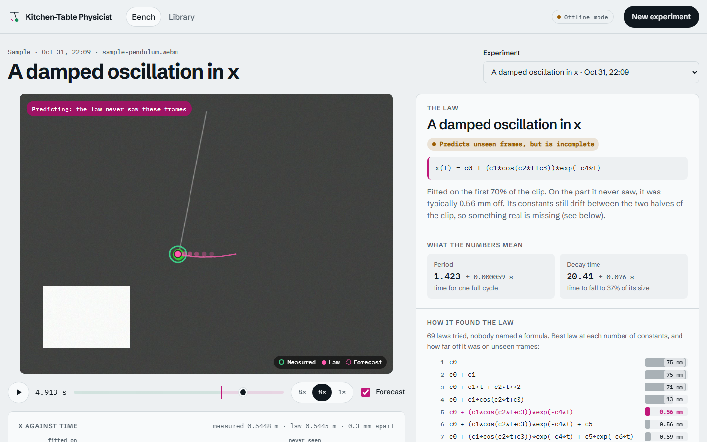

# Kitchen-Table Physicist

Point a phone at anything that moves. It works out what to watch, measures it, discovers the law behind
it with error bars, tries to break that law, proposes the experiment that would test it, and remembers
everything in a personal library of laws.

```
clip.mp4 ─► see.py ─► track.py ─► law.py ─► conserve.py ─► library.py ─► report.py + overlay.py
            (what to   (pixels →   (law ± σ,   (what stays    (memory,      (lab report,
             watch)     metres)     self-test)  constant)      re-testing)   prediction video)
```



## Run it

```
pip install -r requirements.txt
python app.py            # open http://127.0.0.1:8000
```

The first launch renders a sample pendulum with known physics and analyses it, so the app opens on a
working example. Then **New experiment**: drop a clip, say what to track, watch the stages run, and read
the result on the bench:

- **The replay.** The clip with the tracked point (green) and the law's position (magenta). The forecast
  dots show where the law puts the object over the next half second. After the 70% line the law is
  predicting frames it never saw.
- **The chart.** The law line is drawn in full; the measured dots land on it as the clip plays.
- **The notebook.** The law in words and as a formula, its constants with error bars, the ladder of laws
  the search climbed, the self-test, conserved quantities, how the clip fares against your library, and
  the next experiment (with a model key).
- **The library.** Every law found, searchable, marked standing, incomplete or broken by a later clip.

The app is stdlib Python plus plain HTML/CSS/JS: no build step and no extra dependencies. It listens on
localhost only and has no login, so keep it there unless the network is yours.

Command line, same pipeline:

```
python lab.py clip.mp4                                         # vision model decides everything
python lab.py clip.mp4 --color green --fps 240 --note "keys on a 30 cm string" --offline   # no API key
python lab.py clip40.mp4 --verify runs/clip/fit.json           # test the last run's prediction
python library.py search pendulum
```

The Meta Model API is needed for `see.py` (Muse Wonder), SAM tracking and the reasoning agent in `law.py`
(Muse Spark). Set `MODEL_API_KEY` in your environment; `MODEL_BASE_URL`, `MUSE_MODEL` and
`WONDER_MODEL` override the defaults. Everything else runs offline.

## What it does now (verified)

Results below come from the test scripts (`python test_*.py`; `test_app.py` drives the web app over HTTP
end to end, including upload limits, path traversal and video range requests). The L1 test renders a
pendulum video with known physics and runs the real tracker on it; **no real phone footage has been run
yet**, and the API paths have not been called live.

| | Result |
|---|---|
| Video → law, end to end | rendered 0.5 m pendulum: A4 sheet found automatically for scale (within 2%), law `c0 + c1·cos(c2·t+c3)·exp(−c4·t)` found with no family given, **g = 9.743 ± 0.001 m/s²** (truth 9.81; the gap is the 15° swing and scale, the ± is statistical only) |
| Discovery without families | symbolic beam search over sums of generic terms, grown from the residual; finds **damping unprompted** on a damped oscillator and `t²` on free fall (g = 9.81 within 3σ) |
| Error bars | every constant and every derived number (g, period, prediction) gets ± σ from the fit covariance, computed in code, never by the model |
| Self-falsification | each law is refitted on each half of the clip; drifting constants mean the law is incomplete. It caught an undamped law on a damped clip, and on the rendered pendulum it flagged that frequency drifts as the swing decays (real large-angle physics a constant-frequency law can't describe) |
| Conserved quantities | from the state alone it found **`vx + 2.0·vx1 = const`** in a two-body collision (momentum, mass ratio 2 recovered) and **`g·y + v²/2 = const`** for a pendulum (g within 5%); on the damped one it correctly refused to call energy conserved and found the arc `y = x²/2L` instead |
| Closed loop | a prediction is an expression in the fitted constants, so its value ± σ is computed; the next clip's measurement is checked in code: CONFIRMED / REFUTED within `--tol` (5%) |
| Library | `laws.jsonl` keeps every law; `check` re-tests old laws on a new clip and flags the ones it breaks (an undamped law learned from a short clip is caught by a longer one) |
| Sandbox | model-written expressions: character whitelist, no `__`, whitelisted names only, no builtins |

## How it decides

- **Holdout decides, not the model.** Every law is fitted on the first 70% of the clip and scored on the
  unseen 30% (BIC-style score: error plus a penalty per parameter). The beam search ranks candidates by BIC
  on the fit part and only the final ranking uses the holdout.
- **No hardcoded experiments.** The search composes constants, powers of t, waves and decays and wraps any
  term in a decay; starting guesses come from the data (mean, slope, FFT peak of the residual). The agent can
  propose any other numpy expression on top.
- **The vision model chooses the scale reference** (paper, card, coin, door) and its size; OpenCV finds a
  white sheet first when one is there.

## Filming checklist

Phone static on a stack of books, square to the plane of motion, reference object in that same plane,
slow-mo, good light. If periods come out ~8× off, pass the real `--fps`: slow-mo files often report 30.

## Known limits

- SAM 3.1 response parsing (`track.py: first_box`) and Muse Wonder's video input are written against the
  OpenAI-compatible shape, not yet checked against a live response. Marked `ponytail:` in the code.
- Frames where any object is lost are dropped, not interpolated.
- σ is statistical. Scale error (reference size, perspective) is a systematic error on top of it.
- Audio (sound vs motion, resonance) is not built yet.
